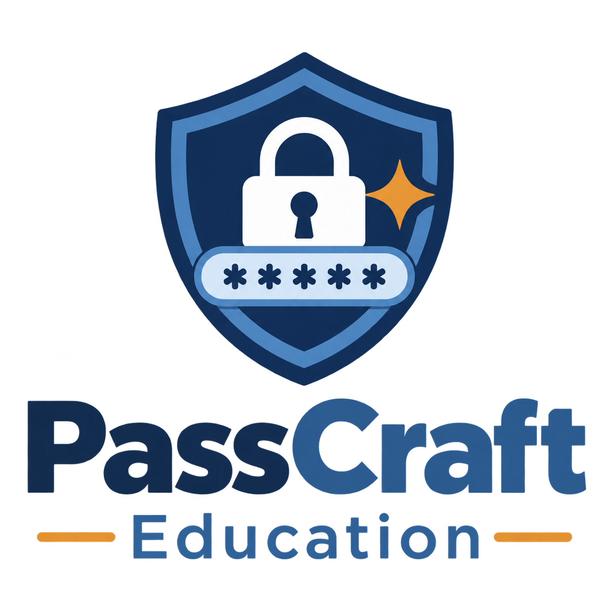

<div align="center">



# PassCraft Education

**Strong, memorable passwords and passphrases — built for students and schools.**


[**🌐 Try it live**](https://guilliharold.github.io/passcraft-education/) · [Overview](#overview) · [Features](#features) · [How to use it](#how-to-use-it) · [What it's for](#what-its-for) · [How passwords are built](#how-passwords-are-built) · [Privacy](#privacy-and-safety) · [Good to know](#good-to-know) · [Project structure](#project-structure) · [Licence](#licence)

</div>

> [!NOTE]
> 🚧 **The next major release of PassCraft is in development and is expected prior to 2027.** This README describes the current public version.

---

## Overview

Weak and commonly reused passwords are a significant security concern within educational environments. Students often select simple authentication details such as personal names, dates of birth, or default passwords like “password123,” which can increase the risk of unauthorised access to their accounts.

PassCraft Education supports the development of strong, memorable passwords through a clear, visual, and engaging process. It generates credentials based on easily recallable word combinations, displays the strength of each password, and encourages best cybersecurity practices via an integrated Learning tab.

It runs entirely in the browser. There is nothing to install, no account to create, and no sign-up. **[Try PassCraft Education live](https://guilliharold.github.io/passcraft-education/)**.

This tool is suitable for use during account setup, password recovery, or as part of a digital literacy program within educational settings. It is also appropriate for individuals seeking to create secure yet memorable passwords or passphrases.

---

## Features

PassCraft is a single page with four tabs.

### 🔑 Password

- Choose a pattern: **✏️ Adjective + Noun** (e.g. `CleverRocket83@`) or **🎨 Colour + Animal** (e.g. `BlueDingo47!`).
- Every password follows the same formula: **Word + Word + Number + Symbol**.
- A password is generated as soon as you pick a pattern, and again each time you press **Generate Password**.
- A colour-coded pill row shows the formula used for the current password.
- A five-bar **strength meter** rates each result from *Very Weak* to *Very Strong*.
- One-click **copy** to the clipboard.
- **Print Password Slip** button (see below).

### 💬 Passphrase

- Chain **3 to 6 random words** drawn from all four word lists (adjectives, nouns, animals and colours).
- Choose a separator style:
  - `CapitalWords` (e.g. `CoralKoalaStorm83@`)
  - `word-dash` (e.g. `clever-mountain-falcon47!`)
  - `word.dot`
- Optionally append a **two-digit number** and a **symbol**.
- Includes the same strength meter, copy button and printable slip as the Password tab.

### 📋 History

- Keeps your last **12** generated passwords and passphrases, newest first, labelled by type or pattern.
- **Copy** or **print** any past result.
- **Clear History** empties the list.
- History lives only in memory for the current visit. It is gone when you close or reload the page.

### 📚 Learn

Short, practical password-safety tips written for students:

- **Never use these**: the most commonly guessed passwords (`password`, `123456`, `qwerty`, `abc123`, `monkey`, `letmein`, `iloveyou`, `admin`).
- **Examples**: memorable passwords in the styles PassCraft generates.
- **Don't reuse passwords**: why one breached account can put the rest at risk.
- **Keep it secret**: never share a password, not even with friends or school IT staff.
- **Longer = stronger**: why length matters.
- **Make it memorable**: how the word patterns create an easy-to-recall mental picture.

### 🖨️ Printable password slip

Any generated password can be printed on a tidy slip that includes the PassCraft branding, the password, a reminder to keep it secret and not share it, and the date. It is formatted for a standard print dialog, so it works with a physical printer or “Save as PDF”.

---

## How to use it

1. **Open the site:** [guilliharold.github.io/passcraft-education](https://guilliharold.github.io/passcraft-education/). No download needed.
2. **For a password:** stay on the **Password** tab, pick **Adjective + Noun** or **Colour + Animal**, and read your result. Press **Generate Password** for a fresh one.
3. **For a passphrase:** open the **Passphrase** tab, set the number of words, choose a separator and any extras, then press **Generate Passphrase**.
4. **Check the strength meter**, then press **📋** to copy the result.
5. **Save it safely**, either in a password manager or on a printed slip kept somewhere secure.
6. **Use it on one account only.** Generate a new one for every site or app.
7. Open the **Learn** tab for the reasoning behind these habits.

---

## What it's for

- 🏫 **Classroom digital-literacy lessons:** a hands-on way to show what a strong, memorable password looks like.
- 🆕 **Account setup:** creating a first password for a new student account.
- 🔄 **Password recovery:** choosing a fresh password after a reset, with a printable slip to hand over.
- 🧑‍🏫 **Teachers and school IT staff:** a friendly, no-login tool to point students to.
- 👤 **Anyone** who wants a password or passphrase that is easier to remember than a random string of characters.

---

## How passwords are built

| | Password patterns | Passphrase |
|---|---|---|
| **Words** | One from each of two lists | 3 to 6 from all four lists combined |
| **Number** | Always, two digits (10–99) | Optional, two digits (10–99) |
| **Symbol** | Always, one of `! @ # $ % & * ?` | Optional, one of `! @ # $ % & * ?` |
| **Example** | `BlueDingo47!` | `clever-mountain-falcon47!` |

**Word lists**

| List | Words | Examples |
|---|---|---|
| Adjectives | 64 | Brave, Clever, Swift, Mellow |
| Nouns | 64 | Mountain, Rocket, Lantern, Oasis |
| Animals | 58 | Dingo, Koala, Quokka, Kookaburra |
| Colours | 60 | Teal, Crimson, Lavender, Viridian |

Random choices use the browser's built-in **`crypto.getRandomValues`**, a cryptographically secure source, rather than `Math.random`.

The **strength meter** is a simple guide. It scores length (8, 12 and 16+ characters) and the mix of uppercase letters, lowercase letters, numbers and symbols, and shows the result as one to five bars.

---

## Privacy and safety

- Passwords and passphrases are **generated locally in your browser**. They are not stored or sent anywhere.
- There are no accounts, no cookies and no tracking in this version.
- The page loads its fonts (Nunito and Baloo 2) from **Google Fonts**, so the browser makes a request to that service when the page opens.
- **Never share a generated password** with anyone, including friends, teachers or school IT staff.
- Printed slips should be kept somewhere safe and shredded or otherwise destroyed when no longer needed.

---

## Good to know

- Example passwords shown on the site and in this README are **illustrations only**. Don't use them. Generate your own.
- PassCraft's passwords are built from word lists and a simple pattern so that they are **easy to remember**. That makes them less random than a long password made by a password manager.
- For important accounts such as email, banking or anything that can reset other accounts, a **password manager** and **multi-factor authentication** are the better choice.
- Adding more words to a passphrase makes it longer and harder to guess.
- The strength meter is an educational guide, not a guarantee.

---

## Project structure

```
index.html     The page: all four tabs and the print slip
style.css      Styles (Navy & Slate palette, responsive layout, print rules)
script.js      Word lists, generator logic, strength meter, history, clipboard, printing
images/        Logo and favicons
README.md      This file
LICENSE        MIT licence
```

### Hosting and running locally

PassCraft is hosted on GitHub Pages at **<https://guilliharold.github.io/passcraft-education/>**, so there's nothing to run or install.

If you'd like to run your own copy or make changes, there is no build step or dependencies. Download or clone the repository and open `index.html` in a modern browser.

### Built with

Plain **HTML5**, **CSS3** and **vanilla JavaScript**. No frameworks and no libraries.

---

## Licence

Released under the [MIT License](LICENSE). © 2026 Harold Guilline.

---

<div align="center">

**PassCraft Education** — Helping students stay safe online 🌿

</div>
